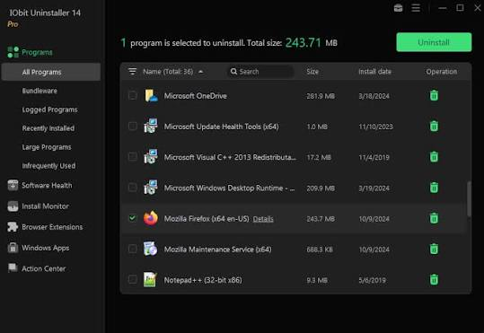
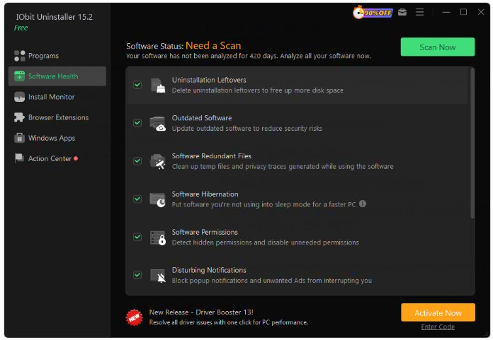

# IObit Uninstaller for Managing Windows Software Removal

IObit Uninstaller helps remove unwanted programs, browser extensions, and Windows apps.
It also provides tools for reviewing installation changes and finding residual items.

IObit Uninstaller Pro is the paid edition with additional capabilities.
This independent IObit Uninstaller guide explains removal decisions and ways to review the result.

[](https://iobit-uninstall-proerfessional.github.io/IObit-Uninstaller/)

The supplied source snapshot belongs to UniGetUI, a separate package management application.
Links to those files provide comparative implementation and maintenance references.
They are not IObit source code, IObit configuration files, or an IObit installer.

## Features

People researching iobit uninstaller 16 should distinguish program removal from leftover cleanup.
Removing an application and deciding what to do with its saved data are separate decisions.

| Task | Relevant capability | Review point |
| --- | --- | --- |
| Remove a desktop application | Program uninstallation | Confirm the selected product and publisher |
| Process several unwanted applications | Batch selection | Check every selected entry before proceeding |
| Investigate a broken removal routine | Force Uninstall+ | Identify the application associated with the chosen file |
| Review installation activity | Install Monitor | Compare the recorded changes with the intended installation |
| Remove unwanted browser additions | Browser extension management | Check which browser and extension are affected |
| Review remaining items | Residual file and registry scanning | Distinguish application data from shared resources |

The [official user manual](https://www.iobit.com/product-manuals/iu-help/) describes the available tools.
Check the installed edition before assuming that a particular option is included.

For iobit uninstaller 16 pro, confirm feature availability in the application and current product documentation.
Version numbers and licensing terms should be recorded when comparing behavior between computers.

The supplied UniGetUI packaging references show how another application describes its environment:

- [UniGetUI.iss](UniGetUI.iss) defines its Windows installer.
- [unigetui-min.winget](configuration.winget/unigetui-min.winget) describes its minimal runtime dependencies.
- [unigetui-all.winget](configuration.winget/unigetui-all.winget) describes a broader development and runtime environment.
- [unigetui.template.nuspec](package/chocolatey/unigetui/unigetui.template.nuspec) contains Chocolatey package metadata.

These files identify UniGetUI packaging choices.
They do not specify IObit installation requirements or supported removal switches.

### App Removal

A practical iobit uninstaller pc workflow begins with identifying the exact application.
Similar display names can refer to different products, versions, or installation scopes.

- Compare the displayed publisher and version.
- Close the target program and save its open documents.
- Read the original uninstaller's prompts.
- Review the completion status before evaluating leftovers.
- Check whether the application requests a restart.

Keep the distinction between program files and user-created documents clear.
A saved project or exported report may still be useful after its creating application is removed.

When an ordinary removal fails, record the original error before trying another method.
This makes it easier to distinguish a missing uninstaller from an application that is still running.

UniGetUI's [chocolateyUninstall.ps1](package/chocolatey/unigetui/tools/chocolateyUninstall.ps1) is a package-specific removal script.
Its executable switches target UniGetUI packaging and are not IObit command-line instructions.

## Usage

An inventory can help establish which application entry you intend to remove.
The following PowerShell example calls WinGet, Microsoft's separate package management tool.

```powershell
$inventoryTool = "winget"
$productName = "IObit Uninstaller"
& $inventoryTool list --name $productName
```

This command lists matching installed applications; it does not request their removal.
It assumes WinGet is already available and may display source-related prompts.

Microsoft documents the filtering options in the [WinGet list reference](https://learn.microsoft.com/en-us/windows/package-manager/winget/list).
The output is an inventory aid and does not identify every possible leftover.

A sensible review sequence is:

1. Identify the application and the installation you intend to remove.
2. Complete its normal removal process where available.
3. Read the result and any restart request.
4. Inspect proposed residual items in context.
5. Confirm that applications you still need continue to work.

The supplied UniGetUI automation references cover its own command interface:

- [run-cli-e2e.ps1](testing/automation/run-cli-e2e.ps1) contains an end-to-end test runner.
- [cli-e2e.manifest.windows.json](testing/automation/cli-e2e.manifest.windows.json) describes a Windows test configuration.

Those files are useful for studying how a different project organizes command tests.
They do not confirm an IObit Uninstaller CLI.

## Screenshots

A useful screenshot records the selected product and the stage of the removal process.
Include enough context to distinguish an inventory view from a residual-item review.



For a cleanup review, make the item paths and categories readable.
Avoid treating the number of detected items as proof that every item should be removed.

- Capture the original error when reporting a failed uninstall.
- Include the affected application version.
- Show the completion message or restart request when relevant.
- Hide account names and private file paths before sharing.

The UniGetUI snapshot includes two related interface-maintenance references:

- [update-icons.ps1](scripts/update-icons.ps1) maintains its icon database.
- [Assert-UniGetUIVisible.ps1](testing/desktop-smoke/Assert-UniGetUIVisible.ps1) checks that its window is visible during desktop testing.

These are project maintenance tools rather than IObit interface components.

## Frequently asked questions

**Does an application inventory prove that all leftovers are gone?**

No. An inventory lists recognized entries, while remaining files and settings require separate interpretation.
An empty search result is therefore not a complete cleanup report.

**How can I inspect conventional desktop application registrations?**

The following example uses Windows PowerShell registry access.
It reads common uninstall locations and displays entries with a product name.

```powershell
$uninstallKeys = @(
    "HKLM:\Software\Microsoft\Windows\CurrentVersion\Uninstall\*",
    "HKLM:\Software\WOW6432Node\Microsoft\Windows\CurrentVersion\Uninstall\*",
    "HKCU:\Software\Microsoft\Windows\CurrentVersion\Uninstall\*"
)
Get-ItemProperty -Path $uninstallKeys -ErrorAction SilentlyContinue |
    Where-Object { $_.DisplayName } |
    Select-Object DisplayName, DisplayVersion, Publisher
```

The example uses [Get-ItemProperty](https://learn.microsoft.com/en-us/powershell/module/microsoft.powershell.management/get-itemproperty).
It does not remove entries and does not enumerate every installation type or every Windows user.

**Should a failed removal be followed by deleting the program directory?**

Record the failure and identify the affected application first.
Deleting a directory alone may leave the application's registered components unresolved.



## Translations

Localized labels can differ while describing the same removal stage.
When reporting an issue, include the interface language and the visible wording.

Keep product names, versions, and error codes unchanged when translating a report.
These details help another reader identify the same application entry.

The supplied UniGetUI translation tooling includes:

- [Verify-Translations.ps1](scripts/translation/Verify-Translations.ps1) checks translation resources.
- [Get-TranslationStatus.ps1](scripts/translation/Get-TranslationStatus.ps1) reports translation status.

Those scripts concern UniGetUI language resources.
They are not language packs for IObit Uninstaller.

## Contributions

Documentation changes should explain a specific task or correct a verifiable detail.
State the application version and separate observed results from illustrative examples.

The supplied UniGetUI maintenance files provide additional comparison material:

- [generate-integrity-tree.ps1](scripts/generate-integrity-tree.ps1) generates a file integrity manifest.
- [verify-integrity-tree.ps1](scripts/verify-integrity-tree.ps1) checks that manifest against files.
- [run-installer-path-tests.ps1](testing/automation/run-installer-path-tests.ps1) contains installer-path testing logic.
- [cli-e2e.manifest.linux.json](testing/automation/cli-e2e.manifest.linux.json) describes its Linux command tests.
- [cli-e2e.manifest.linux-nativeaot.json](testing/automation/cli-e2e.manifest.linux-nativeaot.json) describes its native Linux test configuration.

These references do not imply that IObit Uninstaller supports Linux.
For IObit-specific behavior, consult the [official product page](https://www.iobit.com/en/advanceduninstaller.php) and its user manual.

## Related Search Terms

IObit Uninstaller Pro, IObit Uninstaller, iobit uninstaller 16, iobit uninstaller 16 pro, iobit uninstaller pc, windows, windows-11, uninstaller, uninstall, application-uninstaller, software-management, bloatware, cleanup, package-manager, winget
